# Busy Bar Sign

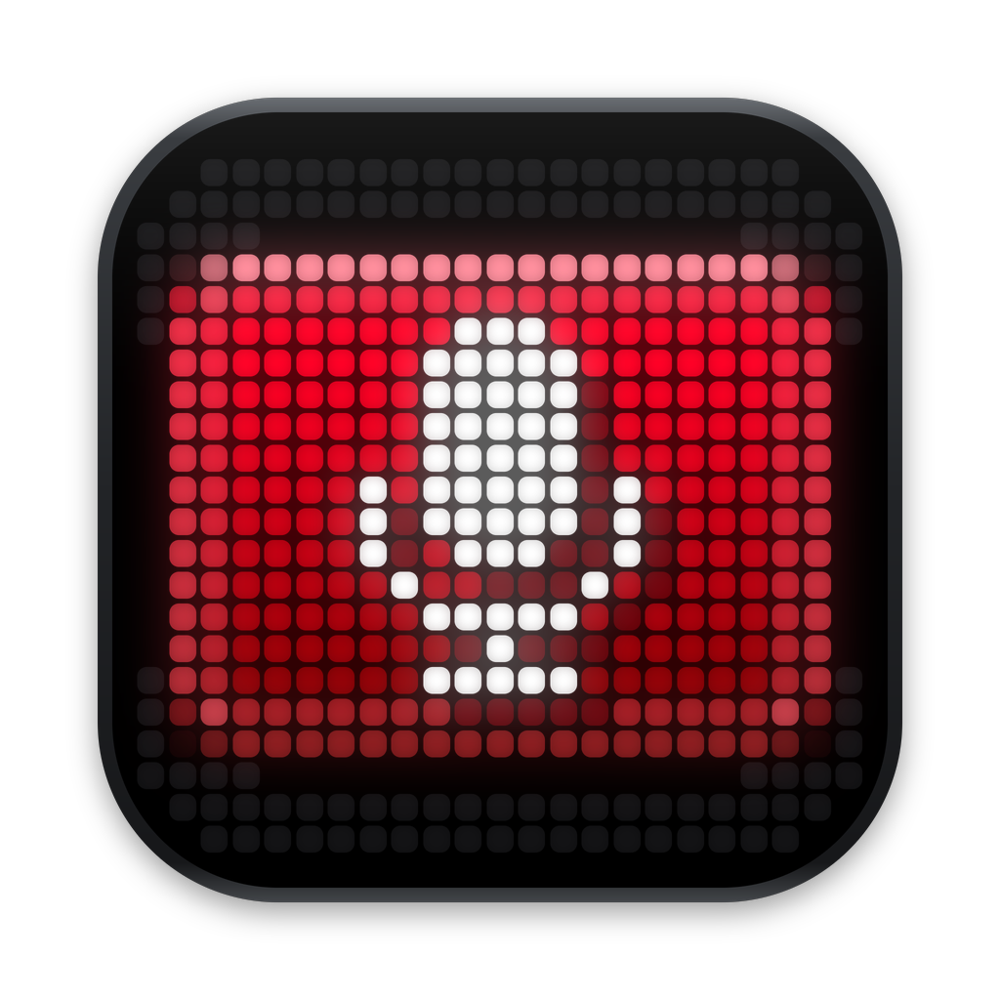

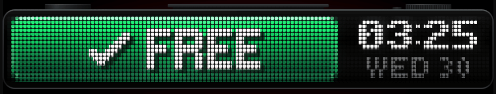

A full-screen wall display for a Mac: a pixel-LED status bar in the style of
Flipper's BUSY Bar, showing **ON A CALL** or **FREE** beside a clock — or the
same bar as a small floating window on your desk screen, or a **stacked
layout** that fills a small monitor. Double-click it for a 30-minute **Do Not
Disturb**. The
state is detected automatically from which app has your microphone — Zoom,
Teams, Google Meet, FaceTime, or anything else — and from **your calendar**:
it warns people ten minutes before a call (**CALL IN 09:41**), says when
you're **LATE FOR** one, shows **MEETING**, **LUNCH**, **AWAY** and **OUT OF
OFFICE**, and on a call counts down to when you're free.
[More below](#your-calendar). When you're **muted** on a call, the mic on the
sign gets a slash and flashes, so the room knows it can talk
([below](#muted-on-a-call)). On a **Stream Deck**, a **Status** key shows the
sign and starts Do Not Disturb, and **Mute** and **Leave** keys work your
Teams or Zoom meeting from anywhere ([below](#stream-deck)). Leaving your
desk, a **Nearby** (or a word of your own for it, such as **W HOUSE**),
**Lunch** or **Back In** key (Back In counts down: ten minutes a press) locks the Mac and the sign stays up on every screen,
through its own **screen saver** ([below](#while-youre-away)). It **updates
itself** when you're off calls ([below](#updates)).

**See it without installing anything:** download the repo and open
`simulator/index.html` in a browser. It runs the same drawing engine and
the same calendar rules as the app, on your real clock. Its buttons show the
floating window and the stacked layout, **Calendar day** plays a working day
through the rules, and the redesigned settings window is beneath; double-click
the bar for Do Not Disturb.

The first version — a broadcast studio clock beside an on-air-style sign,
called Studio Call Sign — is kept on the
[`v1-studio-call-sign`](../../tree/v1-studio-call-sign) branch; its mock is `mock.html`.

| ON A CALL | FREE |
|---|---|
| 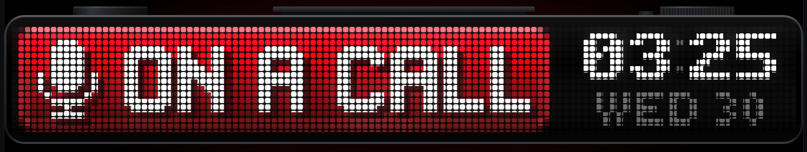 | 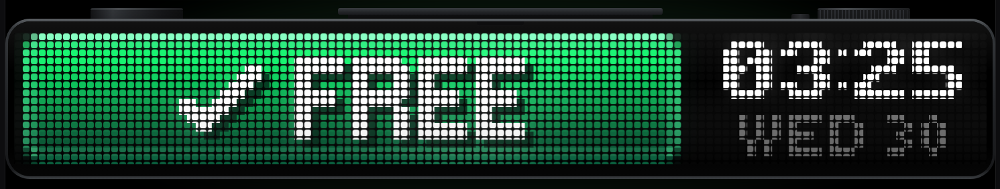 |

As a floating window (the simulator's **Floating window** button shows this):

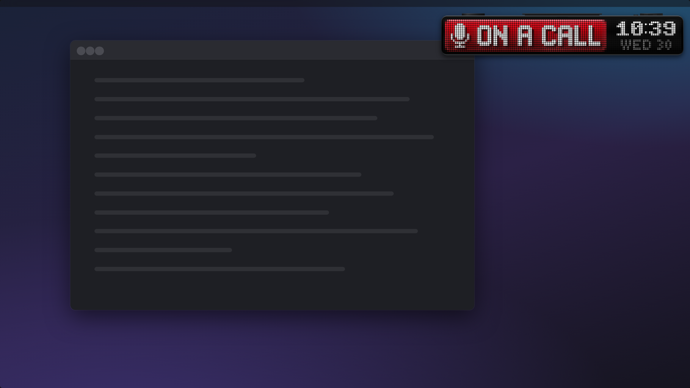

On a small monitor such as 960 × 540, with **Layout** set to **Stacked** (the
simulator's **Stacked layout** button shows this — [more below](#small-screens-the-stacked-layout)):

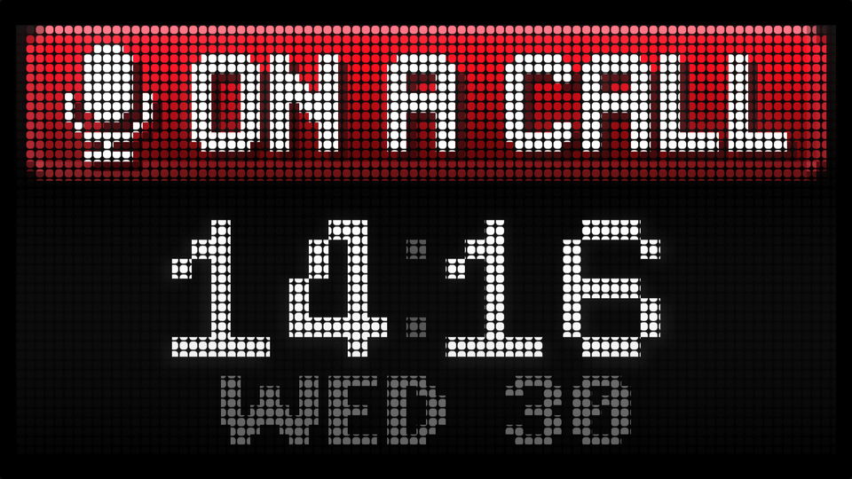

## Download

**[Download the latest build](https://github.com/woody438/busy-bar-sign/releases/latest)**
(`BusyBarSign.zip`).

1. Unzip it and drag **Busy Bar Sign** into Applications. (If you have the
   older **StudioCallSign** there, delete it: that was this app's old name.)
2. Open it. The first time, macOS says it can't check the app for malicious
   software, because it isn't notarised by Apple. Click **Done**, then go to
   System Settings ▸ Privacy & Security, scroll down, and click **Open Anyway**.
   (Or in Terminal: `xattr -dr com.apple.quarantine "/Applications/Busy Bar Sign.app"`.)
3. The full-screen display opens on your second monitor, and a **controls
   window** opens on your main one. Click the app's Dock icon to bring the
   controls back at any time.
4. Allow **Accessibility** when it asks (or Settings ▸ Meetings ▸ **Allow…**):
   it's how the sign sees you're muted, and how the Stream Deck's Mute and
   Leave keys press Teams and Zoom. If Settings says it isn't allowed though
   Busy Bar Sign is switched on in System Settings, press **Reset and ask
   again**.
5. For a Stream Deck, also download `BusyBarSign.streamDeckPlugin` from the
   same release ([more below](#stream-deck)).

That's the only time you install it by hand: from 2.1 on it **updates
itself** from the latest release, keeping its permissions, with no Open
Anyway ([Updates](#updates)).

It runs on Apple silicon and Intel Macs with macOS 14.4 or later. Every push
to `main` rebuilds it on GitHub's Mac runners
(`.github/workflows/build.yml`) and replaces the release. A pull request's
build is published as the **preview** pre-release instead, for trying before
it's merged.

> **In use on one Mac.** It runs day to day on its author's Mac — the sign,
> the microphone, an Outlook calendar, real Teams and Zoom meetings and the
> Stream Deck's Status, Mute and Leave keys — and its checks pass on every
> build, but it hasn't been tried on many other setups. See
> [What's been verified](#whats-been-verified--and-what-hasnt).

## Build it yourself

You need macOS 14.4 or later, **Xcode 15.3 or later** (the Core Audio process
API it uses first appears in the macOS 14.4 SDK; older Xcode won't compile it),
and [Homebrew](https://brew.sh).

```sh
git clone https://github.com/woody438/busy-bar-sign
cd busy-bar-sign
brew install xcodegen
xcodegen generate
open BusyBarSign.xcodeproj           # then Product ▸ Run (⌘R)
```

Or without opening Xcode:

```sh
xcodebuild -project BusyBarSign.xcodeproj -scheme BusyBarSign \
  -configuration Release -derivedDataPath build build
open "build/Build/Products/Release/Busy Bar Sign.app"
```

- It signs with **Sign to Run Locally**, so no Apple developer account is needed.
- Change build settings in `project.yml`, not in Xcode — `xcodegen generate`
  replaces the project, including anything changed in its settings screens.
  Re-run it after adding or removing source files.
- There are no permission prompts: the app checks whether devices are *in use*;
  it never records.

## Setting up the wall display

- **Use the display's default "looks like 1920 × 1080", or its native
  resolution** (System Settings ▸ Displays). A scaled mode such as "looks like
  2560 × 1440" makes macOS resample the whole screen, so the LED dots can't
  land on whole pixels and may shimmer. The menu warns you if this is the case.
- On first launch the bar opens on whichever display *isn't* your main
  (menu-bar) display, and remembers that monitor. If the wall monitor isn't
  connected yet, it shows on the main display until it is. To move it, pick
  another **Monitor** in the controls window (**Show on** in the menus).
- If the wall monitor sleeps, switches off or is unplugged, the bar waits for
  it rather than jumping onto your desk monitor, and comes back when it does.
- On a secondary display the bar sits above that display's menu bar and Dock,
  so nothing covers it while you're in another app. Clicking it never pulls
  focus from a call: a double-click toggles Do Not Disturb, and single
  clicks do nothing.
- While it's showing, the Mac won't let displays sleep. macOS applies that to
  every display, not just the wall.

## The floating window

As well as the full-screen display — or instead of it — the bar can float on
your desk screen: just the device, in a window that stays above other windows
and on every Space, including full-screen apps.

- Turn it on with **Floating window** in the controls window or either menu.
  **Full-screen display** is a separate switch, so you can have either or both.
- **Drag it anywhere.** It never takes focus, so moving it mid-call leaves
  you in the call app.
- **Floating size** — Small, Medium or Large (600, 900 or 1200 points wide).
  On a Retina screen these put the LEDs on exactly 10, 15 or 20 pixels. Also
  on its right-click menu.
- It remembers where it was, its size, and which views were on when you quit.
  First launch opens the full-screen display only.

## Small screens: the Stacked layout

For a small monitor — say a 960 × 540 desk display — set **Layout** to
**Stacked (small screens)** in the controls window or the menu-bar menu. The
status pill runs across the top, the time sits beneath it in 14-row digits
with the day under that, and the LEDs fill the screen with no case around
them (a small monitor has its own bezel). On 960 × 540 each LED is 11 pixels
and the panel fills 90% of the screen's height.

Everything else works the same: the change animation (the announcement fills
the screen on two lines, then draws up into the pill as the clock rises),
Do Not Disturb (its countdown takes the time's place), and double-clicking.
**Wide bar** stays the default, and the floating window always uses it.

Stacked is made for small screens, where it's cheap to draw (under 1 ms a
frame at 960 × 540). You can use it on a big screen too; on 4K it draws 7
million pixels, and during the second or so of a change's shockwave a slower
Mac may drop below 60 frames a second (never below 30).

## Do Not Disturb

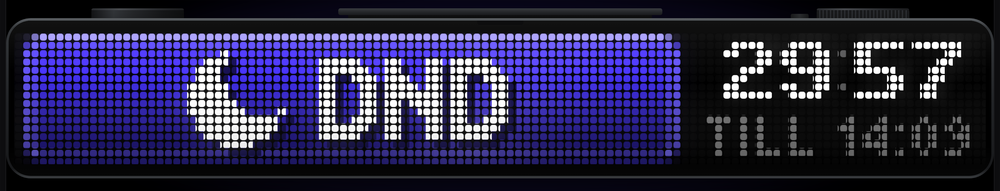

**Double-click the bar** — full-screen or floating — and it goes to
**DO NOT DISTURB** for 30 minutes: an indigo pill with a moon, and a countdown
where the clock was, with its end time beneath. **Double-click again** to end
it and go back to FREE. It's also in the controls window, the menu-bar menu,
the Dock menu and the floating window's right-click menu (**Do Not Disturb
(30 min)** / **End Do Not Disturb**).

- **A call outranks it.** If a call starts, the bar shows ON A CALL; when the
  call ends, it goes back to Do Not Disturb with whatever time is left. The
  countdown keeps running during the call, so a 10-minute call in a 30-minute
  Do Not Disturb leaves about 20 minutes.
- If it runs out during a call, the bar returns to FREE when the call ends.
- It survives quitting and reopening the app.

## While you're away

When the Mac locks, macOS covers every display with its lock screen — the
wall included — and no app can draw over that. A screen saver can. So Busy
Bar Sign carries one, and three **away keys** say where you've gone:

| The bar | What puts it there |
|---|---|
| **NEARBY** — or your own word | The **Nearby** key: in the building, not at your desk. Or the Mac locked with nothing in the calendar to say where you are. Give it a word of your own ([below](#your-own-word-for-nearby)) and the sign says that instead. |
| **LUNCH** | The **Lunch** key — or lunch in your calendar, as before. |
| **BACK IN** · *29:41 AT 14:30* | The **Back In** key: ten minutes a press, so three presses for a half-hour meeting down the corridor. When the time's up, the sign moves on to what's next — NEARBY, if the Mac's still locked. |

The keys are on the Stream Deck ([below](#stream-deck)), in the menu-bar
menu and in Settings ▸ Status.

### Your own word for Nearby

Settings ▸ Status ▸ **The Nearby key says**: type a word — *W House*,
*Studio 2*, *On site* — and press Return. The sign says it in capitals
wherever it would say NEARBY: for the Nearby key, for a locked Mac with
no key on, on the wall, on the Stream Deck's Nearby and Status keys and in
the screen saver. The menus and Settings say it as you typed it. Leave it
empty for NEARBY.

- **About seven letters**: as many as a Stream Deck key can show beneath
  the walker in its 5-row face (W HOUSE just fits; WAREHOUSE and UPSTAIRS
  don't). Settings says so when a word's too long, or has a letter the
  LED fonts don't have (é, ✈), and the sign keeps the word it had.
- The sign fits it as it fits its own words: beside the walker in the
  pill, and in the announcement in the 14-row face — or a step tighter,
  on two lines, or in the 10-row face on the stacked layout, whichever
  fits first.
- The Stream Deck plugin needs 1.4 or later (Busy Bar Sign offers it).
  Stream Deck's own list of actions still calls the key **Nearby**: that
  name is the plugin's, the same for everyone.

**Setting it up**, once:

1. **Settings ▸ Displays ▸ Screen saver ▸ Choose It…** opens System Settings
   at Wallpaper: click **Screen Saver** and pick **Busy Bar Sign**. **Then
   drag the System Settings window to each of your other monitors and do it
   again there**: macOS gives every monitor its own screen saver, and sets
   the one System Settings is on. The app puts the screen saver in
   `~/Library/Screen Savers` itself, and replaces it with each update's.
2. **Lock Screen Settings…** (next to it): set "Require password after
   screen saver begins or display is turned off" to **Immediately**, so the
   screen saver locks the Mac.
3. On the Stream Deck, drag **Busy Bar Sign ▸ Nearby**, **▸ Lunch** and
   **▸ Back In** onto keys.

**Using it:**

- Press a key and go. Three seconds after the last press the screen saver
  starts — and with step 2, locks the Mac — with the sign on every screen:
  the wall's monitor as the wall is set (wide bar or stacked), the others as
  the wide bar. The three seconds are so Back In can be pressed a few times
  first.
- Nearby and Lunch: press again to end. Back In: hold it a second.
- **Unlock and the key's done**: the sign goes back to the microphone and
  the calendar.
- **Lock without a key** (⌃⌘Q, a hot corner) and the sign says NEARBY (or
  your word for it) — on the Stream Deck, and on the screens once the
  screen saver's on (⌃⌘Q's lock screen covers them till then) —
  unless the calendar has something to say: LUNCH, MEETING, CALL IN, LATE
  and the tentative ones still show. A double-click Do Not Disturb waits
  underneath while you're away, and comes back with whatever time is left.
- The microphone still outranks it all: leave a call running and the sign
  says ON A CALL.
- The screen saver asks the app once a second, as the Stream Deck does. If
  the app isn't answering, it says NEARBY — or your word for it, once it's
  heard it from the app.
- **Settings ▸ Status ▸ Start the screen saver** off: the keys just change
  the sign, and don't lock anything.

Worth knowing:

- **⌃⌘Q shows macOS's own lock screen**, not the screen saver; the screen
  saver comes on over it only after the Lock Screen idle time, if at all.
  The app keeps the displays awake while the wall's up, and that may stop
  the screen saver starting by itself too — not yet checked. Lock with a
  key, or a hot corner set to **Start Screen Saver**.
- **Settings ▸ Displays ▸ Screen saver ▸ Last showed on** lists the
  monitors the screen saver has run on since the app opened, and whether
  it drew there. A monitor that isn't listed never ran it — choose it on
  that monitor (step 1). One listed as *not drawing* ran it but drew
  nothing: that's for fixing here.
- **Screen savers from outside Apple are on shaky ground.** Since Sonoma
  they run in an Apple host (`legacyScreenSaver`) that keeps them running
  after they're dismissed, and on Tahoe can leave a second monitor blank.
  This one stops itself when the screen saver ends and quits the host
  shortly after, as Aerial's old screen saver did. Apple's newer one
  is private. If the wall stays black while you're away, that's the
  host.
- If your Mac's screen saver is managed (greyed out, "set by your
  organisation"), you can't choose this one.
- The displays stay on while you're away only as long as macOS lets them:
  the app asks them to stay awake while the wall's up, but if they go dark
  anyway, look at Lock Screen ▸ "Turn display off … when inactive".

## Stream Deck

Six keys for an Elgato Stream Deck, in one plugin, drawn by the bar's own
engine and fonts:

- **Status** — the bar on a key, live: its colour, its words, and beneath
  them the countdown or the time. **Press it** for Do Not Disturb, as you'd
  double-click the bar; press again to end it. On a call the sign stays ON A
  CALL, so the key flashes a tick to say the press counted.
- **Mute** and **Leave** — for the Teams or Zoom meeting you're in, wherever
  its window is ([below](#mute-and-leave-keys-for-teams-and-zoom)).
- **Nearby**, **Lunch** and **Back In** — where you've gone when you
  leave your desk, and the Mac locked behind you ([above](#while-youre-away)).
  Nearby and Lunch are pictures with their word beneath, as Mute and Leave
  are — Nearby's your own, if you've given it one
  ([above](#your-own-word-for-nearby)). Each is lit while it's the one that's on, dimmed while it isn't;
  Back In says **+10** beneath, and counts down once pressed.

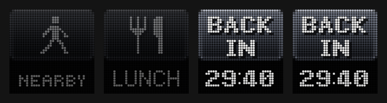

1. Download **`BusyBarSign.streamDeckPlugin`** from the
   [latest release](https://github.com/woody438/busy-bar-sign/releases/latest)
   and double-click it. Stream Deck asks to install it. (Stream Deck 7.1 or
   later.) When there's a newer one, Busy Bar Sign offers it (Settings ▸
   Status ▸ Updates).
2. In Stream Deck, drag **Busy Bar Sign ▸ Status**, **▸ Mute**, **▸ Leave**,
   **▸ Nearby**, **▸ Lunch** and **▸ Back In** onto keys — on as many keys,
   pages and Stream Decks as you like.

- If double-clicking doesn't install it, quit Stream Deck, unzip the file
  (it's a zip) and copy `com.woodall.busybarsign.sdPlugin` into
  `~/Library/Application Support/com.elgato.StreamDeck/Plugins`, then open
  Stream Deck again.
- To work on it: `cd streamdeck && npm ci && npm run build`, then
  `npx streamdeck link com.woodall.busybarsign.sdPlugin` runs it from the
  source folder; `npm run pack` makes the `.streamDeckPlugin`, and
  `npm run sheet` draws every state to `keys.png` to check by eye.

### A Busy Bar screensaver for the Stream Deck

When the Stream Deck sleeps it shows a screensaver across its keys —
Elgato's logo, unless you give it another. No plugin can draw there, but
the screensaver can be the bar: BUSY / BAR in its LEDs, the sheen crossing
the pill as it does on the wall.

Elgato says the screensaver shows while the Mac is locked too. On the
author's Mac (Stream Deck XL, macOS 27) it shows when the deck sleeps
(Settings ▸ General ▸ **Sleep After**), but locking the Mac switches it to
Elgato's logo, even from the screensaver.

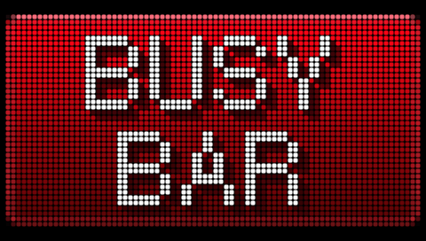

1. Download the one for your Stream Deck: [Stream Deck MK.2 or 15-key](streamdeck/screensaver/busy-bar-mk2.gif)
   (480 × 272), [XL](streamdeck/screensaver/busy-bar-xl.gif) (1024 × 600) or
   [Stream Deck +](streamdeck/screensaver/busy-bar-plus.gif) (800 × 480).
2. In Stream Deck ▸ Settings ▸ Devices, choose your Stream Deck and set its
   **Screensaver** to the file. (Stream Deck 6.6 or later; Elgato says the
   original 15-key Stream Deck takes still images only.)
3. If locking still shows Elgato's logo, try the still instead — the same
   name ending `.png` ([MK.2](streamdeck/screensaver/busy-bar-mk2.png),
   [XL](streamdeck/screensaver/busy-bar-xl.png),
   [+](streamdeck/screensaver/busy-bar-plus.png)) — and quit and reopen
   Stream Deck after setting it.

`python3 tools/screensaver.py` in `streamdeck/` draws them again (it needs
node and Pillow).

### The Status key

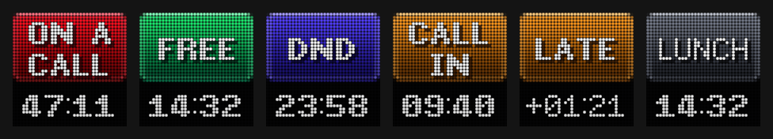

- The words are the bar's, cut to fit a key: ON A / CALL, IN A / MTG for a
  meeting, CALL / IN 09:41, FREE / TILL 15:00, TBC / TILL once a tentative
  meeting is on, OOO, NEAR- / BY, BACK / IN 29:41.
- It asks the app once a second, on the second, so its countdown turns with
  the bar's. While the app isn't running the key says **APP OFF**, and a
  press flashes a warning.
- It reaches the app through a small web server on the Mac itself,
  `127.0.0.1:47811`, which nothing on the network can reach and a web page
  can't use (`Sources/LocalAPI.swift`). If the controls say the Stream Deck
  can't reach the app, something else has that port.

### Mute and Leave keys, for Teams and Zoom

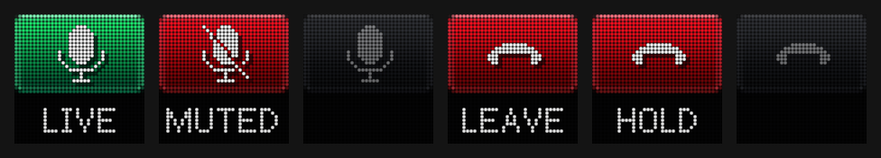

Two more keys in the same plugin, for the Teams or Zoom meeting you're in —
what the separate Teams Meeting Keys plugin did, now done by the app, so
the keys, the sign and the settings always agree:

- **Mute** shows green **LIVE** or red **MUTED**, read from the meeting's
  own mute control; **MIC ?** if the meeting's there but its mute can't be
  read (Zoom before you join its audio); dimmed outside a meeting, with
  **MUTE** in grey. Press to mute or unmute.
- **Leave** shows red **LEAVE** throughout a meeting; dimmed outside one,
  with **LEAVE** in grey. **Press** to
  leave (on release). **Hold it a second** to end a Zoom meeting you're
  hosting for everyone ("End meeting for all"); held in any other meeting it
  just leaves — ending a Teams meeting for everyone isn't done yet. In its
  settings it can be set to leave only when **held** half a second, so a
  stray tap just says HOLD; it then ends for everyone at 1.6 seconds.
- A press clicks the meeting's own button through Accessibility and checks
  it took. If it can't, it brings the meeting window forward, sends the
  app's shortcut (Teams ⌘⇧M / ⌘⇧H, Zoom ⌘⇧A / ⌘W, then Zoom's "Leave
  meeting?" prompt is answered: "Leave meeting" for a press, "End meeting
  for all" for a hold when you're the host) and hands you back the app you
  were in. A press that reached the app is never followed by the shortcut
  until it's had 2.5 seconds to show, so mute can't toggle twice; an app
  that ignores its own button twice gets the shortcut from then on.
- With Teams and Zoom both in meetings, the keys act on the one joined last.
- Teams can redraw its Leave button during a call; the app finds the new
  one within a few seconds. (Before 2.2.1 it lost it for the rest of the
  call, and the Leave key went grey, though a press still left through the
  shortcut.)
- After a call, Teams' "rate your call" survey (and Zoom's "How was the
  audio and video?") is closed — only ever with a Dismiss, Close, Skip or
  Cancel-type button, then the dialog's own cancel, its window's close button
  (never the main window's), then Escape; never Submit or a thumbs. Settings
  ▸ Meetings switches it off and shows the last popup and what was done.
- The app does the pressing, with its own Accessibility permission, so the
  keys need it running. **Remove the old Teams Meeting Keys plugin**: the two
  would both press, and both close the survey.
- Settings ▸ Meetings shows what the keys see — each app's meeting window and
  mute button — and lists every button it can find (**Inspect meeting
  controls**) if Teams or Zoom ever changes them:

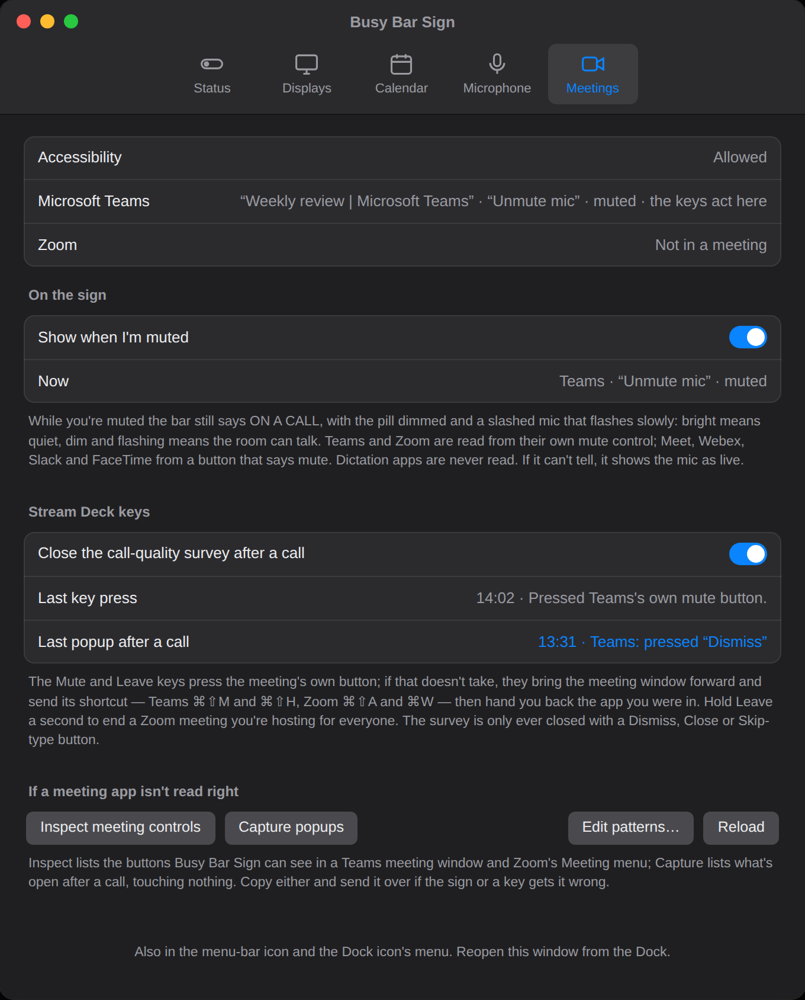

## Your calendar

The sign follows the calendar macOS Calendar shows — for Outlook, add your
Microsoft 365 account in Calendar ▸ Settings ▸ Accounts — read-only. Allow
calendar access when it asks on first launch, then check **Calendar** in the
controls window's Calendar tab is the one you use. It picks the Exchange
account's own "Calendar" by itself.

| The bar | What puts it there |
|---|---|
| **ON A CALL** · *47:12 TILL 11:30* | An app has your microphone. On a call in your calendar it counts down to when you're free, carried through back-to-back meetings (5 minutes apart or less); an hour or more reads *1H05*. Or an event of your own with **call** in the title (e.g. "Call - Linda"), for calls on your phone. |
| **MEETING** · *countdown* | A meeting with invitees and no Teams, Zoom or Meet link. |
| **CALL IN** / **BUSY IN** · *09:41 AT 11:00* | Ten minutes before a call, or a meeting in person. Amber. |
| **LATE FOR** · *CALL +01:20* | A call has started and your microphone hasn't. It pulses, for up to ten minutes, then gives up and shows FREE. |
| **FREE TILL** · *11:00* | You left a call before its slot ended and something else starts straight after it (within 5 minutes): free till then. With nothing straight after, just **FREE**. |
| **CALL TBC** / **BUSY TBC** | Show As **Tentative**: a countdown to the start, then the end time. Never LATE — you may not be going. |
| **DND** | An event titled **No meetings** or **Focus**. Warnings for calls inside it still show. |
| **LUNCH** | An event of your own with **lunch** in the title. It beats any meeting over it, warnings included. |
| **AWAY** | Any other event of your own (no invitees): "Gym", "Drive home". |
| **OUT OF OFFICE** | Show As **Out of Office**, an all-day busy event, or **✈** in the title (flight apps put it there). |

Ignored: Show As **Free**, cancelled meetings ("Canceled: …"), and all-day
events that aren't busy. Declined meetings leave Outlook, so they never count.

**Who wins**, highest first: your **Sign** setting; the microphone; the
[away keys](#while-youre-away); a double-click Do Not Disturb (which waits
while the Mac's locked); then the calendar — out of office, lunch, away, a
phone-call block, an in-person meeting, a call you're late for, a warning, a
tentative meeting; then, with the Mac locked, NEARBY; then a no-meetings
block, and a call you left early with something straight after it.

The title words for your own events are in the Calendar tab: whole words,
any case, separated by commas. Meetings are sorted by their invitees and
join link, so their titles never matter.

Worth knowing:

- **Exchange Web Services is being switched off.** macOS Calendar syncs
  Microsoft 365 over EWS, which Microsoft began turning off on 1 October 2026
  and removes on 1 April 2027; Apple says Calendar will move to Microsoft
  Graph in a macOS 27 update. The app reads whatever Calendar.app holds, so
  it won't need changing — but if your company's EWS goes off before Apple's
  update arrives, Calendar.app stops updating without saying so. The
  controls warn when nothing in the calendar has changed for a couple of
  working days.
- macOS can lag Exchange: a meeting moved in Outlook may take a while to
  move on the Mac. `killall exchangesyncd` makes it sync again.
- When the Mac is locked, the lock screen covers every display, the wall
  included; no app can draw over it. The sign's own screen saver can
  ([While you're away](#while-youre-away)).

## The controls

The same controls are in three places:

- **The controls window** — click the app's Dock icon, or press ⌘, while the
  app is in front. It opens by itself on first launch. Five tabs:
  **Status** (the bar live, why it says what it says, Sign, Do Not
  Disturb, the away keys and the Nearby key's word, and Updates), **Displays** (the full-screen
  display and the floating window side by side, and the screen saver), **Calendar** (which calendar, the warning
  and late times, a guide to what to put in Outlook, and the title words),
  **Microphone** (what counts as a call, and what's using the mic now, to
  ignore) and **Meetings** (Accessibility, showing you're muted, the Stream
  Deck's Mute and Leave keys, the post-call survey, and what to send if Teams
  or Zoom isn't read right).
- **The Dock icon's right-click menu** — full-screen on/off, which monitor,
  floating on/off.
- **The menu-bar icon** — the state's own mark: a tick when free, a
  microphone on a call, a bell before one, a moon for Do Not Disturb, a
  knife and fork at lunch. On a crowded menu bar macOS may hide it; the other
  two always work.

The full menu:

- **Status** — what the sign says and why, e.g. "Call soon: “Weekly review”",
  and what the detector sees, e.g. "Source — zoom.us · mic active · cam active".
- **Sign** — Automatic, or force ON A CALL / FREE (for in-person meetings, recording).
- **Detect** — *Any app except ignored* (default) or *Known call apps only*.
- **Do Not Disturb (30 min)** / **End Do Not Disturb**.
- **Nearby** (or your word for it) and **Lunch** (on/off), **Back In 10 Minutes** (then **Back
  In: 10 More Minutes**) and **I'm Back**: the away keys.
- **Microphone** — every app holding the mic right now, each with an
  **Ignore** toggle. If something that isn't a call lights the sign, ignore it
  here; it's remembered.
- **Full-screen display** (on/off), **Show on** (which monitor; the
  controls window calls it Monitor) and **Layout** (Wide bar, or Stacked
  for small screens).
- **Floating window** (on/off) and **Floating size**.
- **Follow My Calendar** (on/off).
- **Install Update and Reopen** when a new build is waiting, **Update the
  Stream Deck Plugin…** when there's a newer plugin, and **Check for
  Updates**.
- **Settings…** (⌘,) opens the controls window; **Quit** (⌘Q). Opening the app again with nothing showing brings the
  full-screen display back.

## How it decides you're on a call

Once a second it asks Core Audio which processes have microphone input
running (`kAudioProcessPropertyIsRunningInput`, macOS 14.2+). For each one:

1. **Helpers count as their app.** Browsers and Electron apps capture audio in
   helper processes, so each process is traced to the outermost `.app` it runs
   from: Meet in a Chrome helper counts as Chrome.
2. **Dictation and audio tools are ignored** — Wispr Flow, superwhisper,
   MacWhisper, Talon, Krisp, DAWs, OBS — by bundle ID, and dictation tools by
   name too, in case the bundle ID is one it doesn't know.
3. **Apple's own processes are ignored** — Siri, Dictation, Live Captions,
   Sound Recognition (which listens all the time) — **except** FaceTime (whose
   audio runs in `avconferenced`) and Safari (whose audio runs in WebKit).
4. **Anything else counts**, under the default policy. *Known call apps only*
   restricts it to a list in `CallDetector.swift`.

The sign follows only once a change has held: **2 seconds** before it lights,
**10 seconds** before it goes dark, so a moment's silence never flickers it.
Zoom, Teams and Meet keep the mic open while you're muted, so the sign stays
lit through mute — and shows that you're muted, if it can
([below](#muted-on-a-call)).

Worth knowing:

- Some apps release the mic when you mute (Slack huddles and Discord, reportedly).
  During a long mute in those, the sign returns to FREE after 10 seconds.
- The Wispr Flow bundle IDs in the ignore list are best guesses. If dictation
  lights the sign, use **Microphone ▸ Ignore Wispr Flow** once.
- If Core Audio's per-process API ever fails to answer, it falls back to "is
  the default input device in use by anyone" — which can't tell dictation
  from a call. The status line then says "unattributed".

## Muted on a call

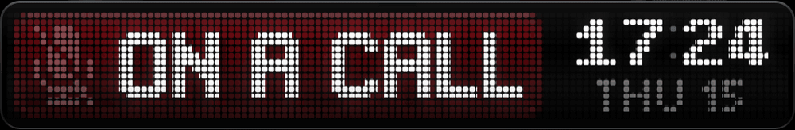

With people in the room on a call, they need to know whether they can talk.
While you're muted the bar still says **ON A CALL** — a passer-by sees the
same red — but the mic gets a slash and flashes slowly (on a second, off
half a second), and the pill dims to a glow: bright means quiet, dim and
flashing means the room can talk. Muting and unmuting change it straight
away, without the change animation.

The Mac's audio system can't see a mute in Teams or Zoom (they keep the mic
open), so the app reads the call app's own mute button through **macOS
Accessibility** — as MuteMe and MuteDeck have done for Teams since Microsoft
retired its device API on 30 June 2026. It reads only the app that has the
mic and counts as your call, so Wispr Flow and the other dictation tools are
never read.

- **Teams and Zoom** are read as the Stream Deck's Mute key reads them
  (`Sources/Meeting/`, a port of Teams Meeting Keys' helper): Teams' mic
  button found by its own id (`microphone-button`) in the meeting window,
  its name read with the patterns below; Zoom's **Meeting** menu, which says
  "Mute audio" or "Unmute audio" only in a meeting. `Checks/meeting` runs a
  scripted Teams and Zoom through it.
- **Anything else** — Meet in Chrome, Edge, Arc or Safari ("Turn off
  microphone"), Webex, Slack huddles, FaceTime's ticked "Mute" menu item — is
  searched for a button whose name reads as a mic mute. `Checks/mute` tries
  each.

Each control is read in one round trip and the search walks the window in
order, which is what lets it reach the button in a big Teams window. Teams
is asked to build its accessibility tree quietly first; if it comes back
empty, it's asked as VoiceOver asks (`AXEnhancedUserInterface`), which in
some apps upsets window managers such as Rectangle.

- macOS asks once for the permission (System Settings ▸ Privacy & Security ▸
  Accessibility), and keeps it across updates as long as each build is signed
  with the project's certificate ([Signing](#signing)). If the app says it
  isn't allowed though Busy Bar Sign is switched on in that list, the entry
  belongs to a build signed differently, and switching it off and on doesn't
  help: press **Reset and ask again** in Settings ▸ Meetings (or remove the
  entry with **–**, or run `tccutil reset Accessibility com.woodall.BusyBarSign`),
  then switch Busy Bar Sign on when System Settings opens.
- If it can't tell — no permission, no mute button found, a label it doesn't
  know — it shows the mic as **live**. It never tells the room it can talk
  unless the app says you're muted.
- A redesign of Teams' or Zoom's meeting window can hide the button until the
  patterns are updated. Settings ▸ Meetings shows what it's reading, e.g.
  "“Eagle Dragon crew | Microsoft Teams” · “Unmute mic” · muted", and
  **Inspect meeting controls** lists every button it can see — copy that and
  send it over. The words it reads (mute labels, survey wording, which
  buttons it may press) are in `~/Library/Application Support/Busy Bar
  Sign/meeting-ui.json` (**Edit patterns…**), in the same format as Teams
  Meeting Keys' `teams-ui.json`; **Reload** picks up a change.
- Switch it off in Settings ▸ Meetings ▸ **Show when I'm muted**.
- The Stream Deck key still reads a muted call as ON A CALL; the local API
  adds `"muted": true` for it.

## How the display works

The bar is **118 × 16 LEDs**. Sixteen rows is what gives the BUSY Bar's type its
chunk, so that's kept; the real device is 72 columns, too narrow to set
"ON A CALL" beside a clock, so this one runs wider. At 32 pixels per LED it
spans a 4K screen exactly: full width, 31% tall, every LED on whole pixels.

Almost everything comes from the BUSY Bar's own open-source firmware:

- **Pixel fonts** — decoded from the firmware (OFL-licensed): `busy_bold_10`
  for the status, `busy_regular_14` for the announcement, `busy_bold_7` and
  `busy_regular_5` for the clock, as the firmware's clock app uses them.
- **Colours** — sampled from its animation frames: the pill's red and green
  gradients, highlight row and rim.
- **Dots** — Flipper's own preview shader: rounded squares at 85% of the
  pitch, shading toward their corners; unlit LEDs vanish into the black face.
  Colours are corrected for the firmware's LED gamma (value^2.6–2.8).
- **Layout** — its timer screen: lit pill on the left; time in white on black
  to the right, day beneath at half brightness; colon dimming on odd seconds.
- **A change of state** — as the device does it: the old screen presses down,
  a ring bursts from the top edge and floods the panel, and the new screen
  springs up. The status fills the bar in 14-row capitals for a few seconds,
  then the pill draws back and the time slides in beside it.

The words are **ON A CALL** rather than the firmware's own "ON CALL", which in
British English means on standby. The mic pictogram echoes the firmware's
on-call theme; the tick is the "available" mark meeting apps use.

In the code:

| | |
|---|---|
| `Sources/Bar/BarEngine.swift` | Decides every LED's colour for a moment in time. A line-for-line port of `simulator/engine.js`. |
| `Sources/Bar/LEDRaster.swift` | Turns a frame into panel pixels: dots, shading, gamma, glass. |
| `Sources/Bar/LEDPanelView.swift` | Runs engine and raster on each display refresh and hands the pixels to a layer. |
| `Sources/Bar/BarDisplayView.swift`, `BarGeometry.swift` | The screen: the device body and where the LEDs go. |
| `Sources/Bar/PixelFonts.swift`, `FontData.swift` | The firmware's fonts. |
| `Sources/CallDetector.swift`, `AudioProbe.swift`, `CameraProbe.swift` | Call detection. |
| `Sources/StatusRules.swift` | Decides what the sign says from the controls, the mic and the calendar. A line-for-line port of `simulator/rules.js`. |
| `Sources/CalendarSource.swift` | Reads the calendar from macOS Calendar (EventKit). |
| `Sources/MuteDetector.swift`, `MuteLabels.swift` | Whether you're muted, from the call app's own mute button (Accessibility). |
| `Sources/Meeting/` | Teams and Zoom through Accessibility, for the sign and the Mute and Leave keys: `MeetingEngine` (a port of Teams Meeting Keys' helper), `MeetingPatterns` (the words it reads), `AXMeetingBackend` (the Mac's side, and the shortcut fallback), `MeetingKeys` (a key press, start to finish). |
| `Sources/StatusModel.swift` | Runs the rules once a second and on every change; everything that shows the sign reads it. |
| `Sources/DisplayWindow.swift` | The full-screen window. |
| `Sources/FloatingWindow.swift` | The floating window. |
| `Sources/BusyBarSignApp.swift`, `ControlsWindow.swift` | The menus and the controls window. |
| `Sources/Away.swift`, `AwayState.swift` | The away keys, and whether you're at the Mac: locked, or the screen saver on. Starts the screen saver after a key. |
| `Saver/` | The screen saver: the sign on every screen while you're away, asking the app as the Stream Deck does. Built from the bar's own engine files. |
| `Sources/SaverInstaller.swift` | Keeps the screen saver the app carries in `~/Library/Screen Savers`. |
| `Sources/LocalAPI.swift`, `LocalServer.swift` | The web server on 127.0.0.1 that the Stream Deck plugin and the screen saver ask. |
| `Sources/Updater.swift`, `UpdateCheck.swift` | Updates: which release is newer, and the download, signature check and swap. |
| `tools/make-signing-cert.sh`, `tools/sign.sh` | The project's signing certificate, made once, and how CI signs each build with it. |
| `streamdeck/` | The Stream Deck plugin: `src/key.js` draws the keys with the simulator's engine; `src/live.js` asks the app once a second for every key; `src/status-action.js`, `src/meeting-actions.js` and `src/away-actions.js` handle presses. |
| `tools/icon/make_icon.py` | Draws the app icon (`Resources/Assets.xcassets`). |
| `simulator/` | The browser version, where the look and the rules are designed. `day.js` is the sample day the day player and the checks use. |
| `Checks/` | Tests that run anywhere Swift does. |

## What's been verified — and what hasn't

**Built on macOS** by GitHub Actions with Xcode 16.4 (Swift 6.1.2): the whole
app, as a universal (Apple silicon + Intel) binary, ad-hoc signed; no compiler
errors or warnings in its code.

**Verified by running**, on macOS by GitHub Actions on every build (`Checks/run.sh`):

- **The Swift engine matches the simulator LED for LED** across 119 moments —
  every state, wide and stacked, through the press, shockwave, announcement,
  collapse, slide-in, LATE's pulse and the muted call's glow and flashing mic,
  NEARBY and BACK IN counting down, each with the countdown the app gives
  it, and words of your own for Nearby through every way of fitting one —
  to within float rounding. Both take and turn away the same words for
  Nearby. What you see in the simulator is what the app draws.
- **The Swift status rules decide exactly what the simulator's do** in 2,995
  cases: a scripted working day every 15 seconds — a call joined late and
  left early with nothing after it, one left early with a call straight
  after, one never joined, an in-person meeting, a tentative one, lunch
  with a call inside it, a no-meetings block, phone calls, a flight — with
  and without the manual controls, plus back-to-back chains, overruns and
  how each kind of Outlook event is read (safelinks, Teams rooms, cancelled
  titles, Show As), and the away keys and a locked Mac across the day. The
  rules themselves have 134 hand-checked cases
  (`simulator/tools/rules-check.js`).
- **The away keys** (`Checks/away`): Nearby and Lunch on and off, Back
  In ten minutes a press from the first (and from then, once it's run out),
  no further than a working day, and running out on time.
- **The screen saver loads and shows the sign** (on every build, after it):
  loaded as macOS's host loads it — the bundle's principal class, made with
  `initWithFrame:isPreview:` — on a screen with a stand-in for the app, it
  shows BACK IN, laid out as the wall on the wall's monitor and as the wide
  bar on any other, asks once a second as the app expects, and stops asking
  when stopped (`Checks/saver-load`). It reads every kind of the app's
  answer right (`Checks/saver`).
- **Every LED lands on whole pixels** on eight common displays — 4K at 1× and
  2×, 1080p, 1440p, 5K, 6K, ultrawide — and at all three floating sizes at 1×
  and 2×, with the whole device inside the window. (This check caught a real bug.)
- **A frame takes under 3 ms** for the wide bar at 4K in the worst case, and
  under 1 ms for the stacked layout at 960 × 540, on four slow virtual
  cores — the display allows 16.7 ms.
- **The call detector makes the right decisions** on a scripted 40 seconds:
  Zoom lights the sign after exactly 2 s and it goes dark exactly 10 s after;
  dictation through a helper, an always-listening Apple process and a
  one-second blip don't light it; both overrides are instant; Meet in a
  Chrome helper does light it; and the microphone's own sessions, which the
  calendar rules use, come out as Zoom 1–7 s and Meet from 31 s.
- **The Stream Deck plugin works end to end** against a stand-in Stream
  Deck and a stand-in app (`streamdeck/test/e2e.js`): it registers, draws
  the key in the sign's colour, redraws a countdown once a second within
  300 ms of the second turning, starts and ends Do Not Disturb on a press,
  shows a tick on a call, turns the Mute key from LIVE to MUTED on a press,
  warns when a press didn't take, leaves only when a held Leave key is held,
  and with the Leave key left on a press, leaves on release and ends the
  meeting for everyone when held a second, lights Back In with ten minutes
  a press and ends it on a hold, turns Lunch and Nearby on and off one at
  a time, has Nearby say the word the app gives it,
  says APP OFF and warns on a press while the app is away, recovers when
  it's back, and stops asking when no key shows it. Its key drawing has 168
  checks of its own: every state the engine has, every word and countdown
  inside the key, the countdown text against the bar's, every face of
  the Mute, Leave and away keys, and the widest words of your own the sign
  takes for Nearby, on the Nearby and Status keys (`streamdeck/test/keys.js`).
- **Teams and Zoom are followed and pressed right** (`Checks/meeting`, Teams
  Meeting Keys' helper tests carried across, and more: 112 checks) against a scripted
  Teams and Zoom: the mute state from the mic button and Zoom's menu; a
  flyout covering the toolbar keeps the last reading for 20 s, a closed
  window or "Rejoin" ends the meeting at once; a press of the meeting's own
  button is checked, and one with no effect asks for the shortcut; Zoom's
  "Leave meeting?" answered with "Leave meeting" on a press, host or not,
  and "End meeting for all" on a hold only when it's offered, never a
  toolbar button of the same name; a Teams meeting window showing only its
  title-bar buttons makes Teams be asked as VoiceOver asks;
  the survey closed with Dismiss and focus handed back, never Submit or a
  thumbs, a stubborn one tried once each way then left, a live meeting
  window never touched, an unknown popup reported once and left alone, a
  chat window full of text never taken for a survey; Inspect and Capture
  never showing chat; and Teams Meeting Keys' own `teams-ui.json` loading
  as a patterns file.
- **Mute buttons are read right** (`Checks/mute`): 37 labels from Teams (in
  English and French), Zoom, Meet, Slack, Webex and FaceTime read as muted or
  live, and the look-alikes — "Mute all", "Mute notifications", "Mute
  speaker", "Ask all to unmute" — ignored.
- **The web server's request handling** (`Checks/http`): requests read
  whole when they arrive in pieces, anything from a web page (an Origin, or
  a Host that isn't 127.0.0.1 or localhost) turned away, and the exact JSON
  the plugin reads.
- The pixel fonts decode correctly, and every source file parses.

**Run on a real Mac** — its author's, with an Outlook calendar through
Calendar.app and an Elgato Stream Deck:

- The app follows the microphone and the calendar through real calls. That
  is how it was found that leaving a call early showed FREE TILL even with
  nothing after it; it now shows FREE (see [Your calendar](#your-calendar)).
- The Stream Deck plugin, installed from its release file, shows the sign
  live on a key through the app's web server.
- On real Teams and Zoom meetings: the mute state read on the sign and the
  Mute key, the Mute and Leave keys pressing the meeting (found here: Teams
  only shows its meeting controls to Accessibility once asked as VoiceOver
  asks, and Zoom's host gets a "Leave meeting?" prompt — now answered), and
  no crash pressing a key with the settings window in front (that was
  found here too).
- An update installing itself — build 35 to build 36 — with no Open Anyway
  and Accessibility still allowed, both builds signed with the project's
  certificate.

**Not yet run on a real Mac:** the away keys and the screen saver, new in
2.2 — whether `Away.swift` sees the Mac lock and unlock and starts the screen
saver (`ScreenSaverEngine`), whether `SaverInstaller.swift` puts it in place,
and above all whether macOS 27's screen saver host shows it on every
monitor, lets it reach the app, and stops it when you're back. The first
build on the author's Mac is the test.

**Run, but on one Mac only:** the AppKit, SwiftUI, Core Audio, EventKit and
Network code — `DisplayWindow`, `FloatingWindow`, `ControlsWindow`,
`BusyBarSignApp`, `LEDPanelView`, `BarDisplayView`, `AudioProbe`,
`CameraProbe`, `CalendarSource`, `StatusModel`, `LocalServer`, `Updater`,
and the Accessibility side of `MuteDetector` and `Sources/Meeting/`
(`AXMeetingBackend`, `MeetingKeys`) — has no automated checks of its own;
the meeting logic beneath it does (`Checks/meeting`). If something
misbehaves on another Mac, these are the likeliest places:

1. `AudioProbe.swift` — the Core Audio process properties: does the menu's
   Microphone list show the app you're calling from?
2. `DisplayWindow.swift` — placement on the wall screen, and the scaled-mode
   warning (`CGDisplayCopyAllDisplayModes`).
3. `LEDPanelView.swift` — the display link (`NSView.displayLink`, macOS 14).
4. `FloatingWindow.swift` — the window's shadow, traced from the device's
   outline; if it's missing or boxy, that's where to look.
5. `CalendarSource.swift` — the permission prompt, and how Exchange events
   arrive through EventKit: does the Calendar tab list your Outlook
   calendar, and during a Teams meeting does the Status tab say "On
   “…”" rather than "Microphone in use"? If a Teams meeting shows MEETING
   instead of a call, its join link isn't where the rules look.
6. `LocalServer.swift` — if the Stream Deck key says APP OFF while the app
   is running, `curl http://127.0.0.1:47811/status` should answer with the
   sign's state; if it doesn't, the listener didn't start (the controls'
   Status tab says why).
7. `Sources/Meeting/` and `MuteDetector.swift` — on a Teams call, Settings ▸
   Meetings should show the meeting window and its mute button (“Unmute
   mic” · muted). If it says "Not in a meeting" or "mute unknown", press
   **Inspect meeting controls**: it lists the meeting windows and every
   button with an id. No `#microphone-button` means Teams has renamed it, or
   isn't exposing its toolbar; a different label means a mute rule in the
   patterns file needs adding. The keys still work meanwhile, through the
   keyboard shortcut.

## Updates

Busy Bar Sign updates itself from this repository's releases. It looks at
launch and every four hours, and installs a newer build when you're not on a
call or in a meeting: it closes, swaps in the new copy and reopens, in a
second or two. **Settings ▸ Status ▸ Updates** shows the build you have,
checks or installs on demand, and can switch the automatic install off; the
menu-bar menu has **Check for Updates** too.

- A copy built from main follows the **latest** release; a pull request's
  preview build follows the **preview** release, then main's once it's
  merged. Each build is numbered by its CI run, and only a higher number is
  an update (`Sources/UpdateCheck.swift`, checked by `Checks/update`).
- It only installs a download signed with the project's certificate — the
  same one as the running copy ([Signing](#signing)) — so the update is the
  same app to macOS and keeps its permissions. A download the app makes
  itself isn't quarantined, so there's no Open Anyway. A copy signed ad hoc
  (built before the certificate, or locally in Xcode) never installs one.
- It needs to be able to replace itself: in Applications, opened from there,
  by someone allowed to change Applications. Otherwise Settings says so, and
  the release page is the way.
- The Stream Deck plugin can't be installed for you — Stream Deck always
  asks first — so once the app is up to date, a newer plugin is opened in
  Stream Deck for you, once per version and only when you're off calls (and
  installing updates automatically): click **Install** when Stream Deck
  asks. Missed it? **Update…** in Settings ▸ Status, or the menu's **Update
  the Stream Deck Plugin…**, opens it again. Settings ▸ Status shows the
  plugin's version.

## Signing

macOS gives permissions such as Accessibility to an app as it's signed. A
build signed ad hoc (Xcode's "Sign to Run Locally") is known only by its own
contents, so every new build is a stranger and has to be allowed again. So
GitHub signs each build with the project's own certificate
(`tools/sign.sh`), and macOS knows them all as the same app.

The certificate is self-signed — made once with
[`tools/make-signing-cert.sh`](tools/make-signing-cert.sh) and kept in the
repository's Actions secrets `SIGNING_CERT_P12` and `SIGNING_CERT_PASSWORD`.
It changes nothing about installing: Apple doesn't vouch for it, so the first
open still needs **Open Anyway**. Without the secrets, builds are signed ad
hoc as before, and the build checks the signing steps with a throwaway
certificate instead. Whoever has the secrets could sign an app macOS would
take for Busy Bar Sign, so they stay secret.

## Running the checks

```sh
Checks/run.sh          # needs swiftc (Xcode), node and npm
```

## Handing this to Claude Code on your Mac

From the project directory run `claude`, then:

> This SwiftUI macOS app, and its Stream Deck plugin in streamdeck/, are in
> use on one Mac — read README.md. Run `xcodegen generate`, build with
> xcodebuild, run Checks/run.sh (it tests the plugin too), then launch the
> app and compare it against simulator/index.html.

## Credits and licences

- Pixel fonts from the [BUSY Status Bar firmware](https://github.com/busy-app/busybar-firmware)
  — © 2021 TakWolf ([Ark Pixel](https://ark-pixel-font.takwolf.com/)), © 2024–2026 Flipper FZCO —
  under the SIL Open Font License 1.1 (`LICENSES/OFL-1.1.txt`).
- The transitions are original code, modelled on the firmware's CC BY-SA 4.0
  animations; no animation frames are included.
- BUSY Bar is a product of Flipper Devices; the name is used here to say what
  this imitates. Not affiliated with or endorsed by Flipper Devices.
